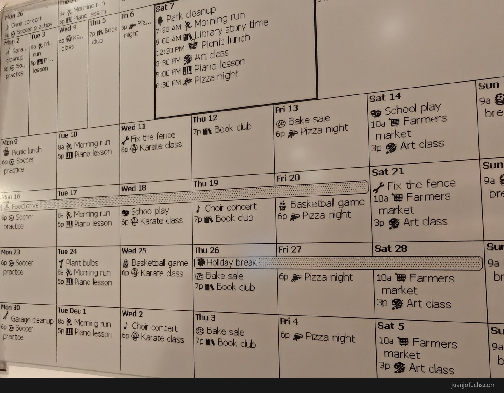
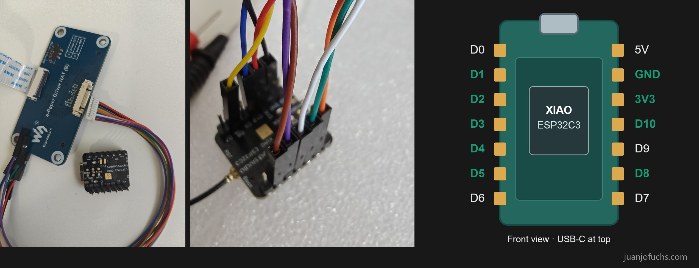
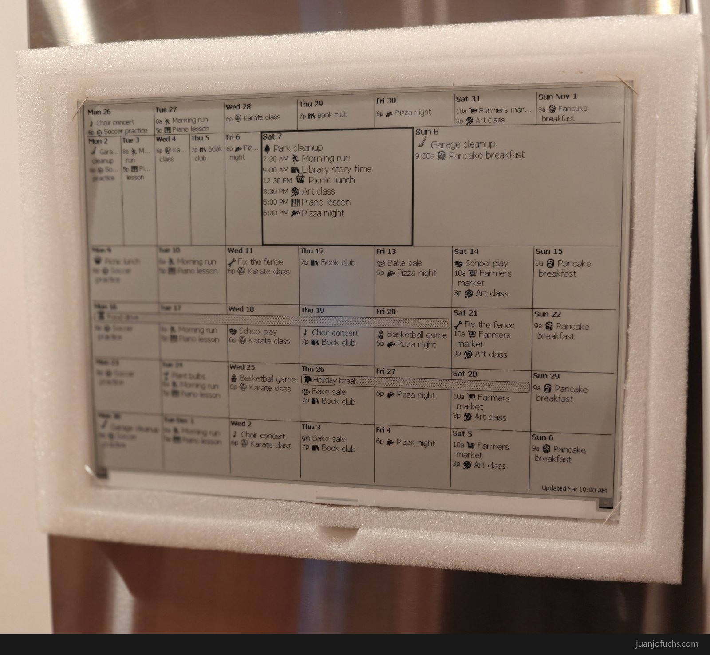
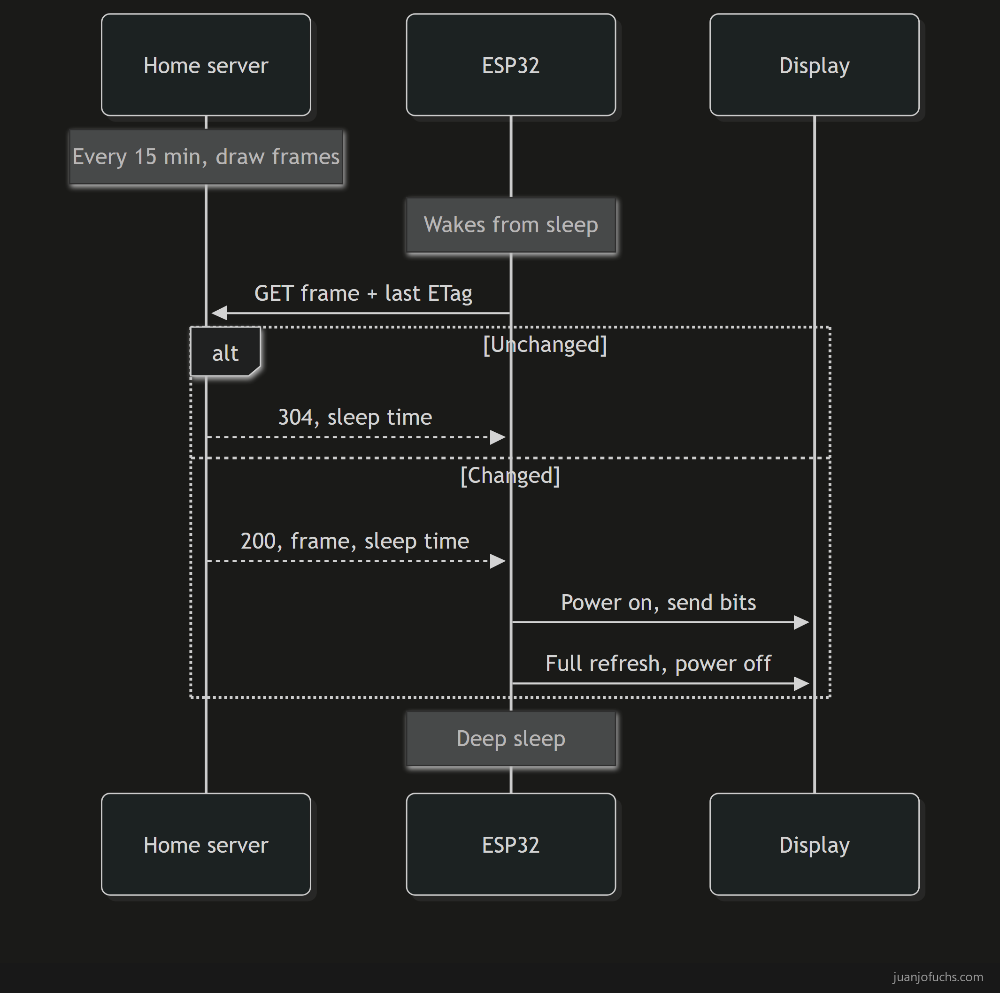
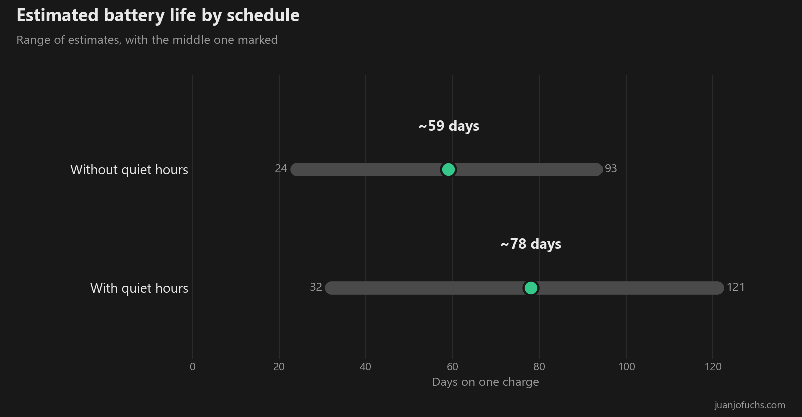

## A calendar on the fridge

I have wanted to display my family calendar on the fridge for quite a while. I was looking for options that don't draw a lot of power and are not too flashy, and I was reading about e-ink displays. Last weekend, with my agents' help, I was finally able to do it. My agents guided me into finding the hardware, comparing the alternatives, purchasing them and then putting them all together, soldering and programming the software.

## Why I wanted to build it

I am a builder. I have always been a builder. And before AI, I built software with my hands, I typed each letter into the keyboard and produced the code manually. But now that AI is here, we can use our voice and actually just speak things into existence, without having to use the keyboard at all. However, I have realized that I still have that need to create something with my hands. And something that AI can't yet do for us is hardware in the physical world. That's one of the reasons I wanted to try to do this hardware project.

I had done research and found some consumer products, for example [TRMNL](https://trmnl.com/), which I liked very much. But I didn't want to buy a finished product nor get into that ecosystem, even though it has [bring your own device](https://trmnl.com/byod), [build your own server](https://docs.trmnl.com/go/diy/byos) and other stuff. I wanted to build something myself that I could fully control. Basically, I wanted to hack something together myself.

## We have a personal teacher now

With AI agents we have a personal teacher now, a teacher that never gets tired of our questions, no matter how obtuse they are, and can walk us through basically anything. If we make good use of the AI and provide the right context, we can get an expert's help doing real-world stuff. It lowers the entry barrier into anything new and unknown, and it gives you confidence.

When I decided I wanted to do this project, my agents and I researched some e-ink displays and settled on the [Waveshare 13.3-inch e-Paper HAT (K)](https://www.waveshare.com/13.3inch-e-paper-hat-k.htm). The idea was to use my Raspberry Pi, a very old one that's been sitting in a drawer for years. But when we were walking through the build, I discovered that the Raspberry Pi would draw too much energy, defeating the purpose of having something that could run autonomously for months without needing to be recharged or plugged in. Then we researched more options and the [ESP32 board](https://www.amazon.com/dp/B0DRNSV5CS), a tiny computer board to run the screen, came along, together with the [battery](https://www.amazon.com/dp/B08214DJLJ). After that iteration, walking through the setup, we realized I didn't have a [soldering kit](https://www.amazon.com/dp/B087767KNW) nor a [multimeter](https://www.amazon.com/dp/B01ISAMUA6).

Neither the AI nor I came up with the design in one shot, nor alone. We went through multiple iterations to evolve it based on what I had and what I wanted. I think the key piece here is iteration, and for iterations to be valuable and additive we need to convey our intent as best as possible, so that the AI knows what we want and can give us back as much understanding as possible. I wrote about it in a previous post and called it [intent per minute and understanding per minute](https://juanjofuchs.com/blog/intent-per-minute).

The way I would iterate through this, when all the parts came, is that I would take pictures of the parts and send them to my agents through [Command Bridge](https://github.com/JuanjoFuchs/command-bridge), the tool I built to talk to them by voice, and my agents would just talk back to me with the instructions on how to set them up. They showed me how to connect the circuitry, [they drew a front view of the board](https://juanjofuchs.com/blog/deixis), and they even walked me through step by step on how to do the soldering.

When I realized the battery connection needed soldering, I did wonder if I should buy [Seeed's expansion board](https://www.seeedstudio.com/Seeeduino-XIAO-Expansion-board-p-4746.html), which has a battery socket and would have saved me the soldering, but I chose soldering because I figured the skill would be useful in the future, rather than just solve it by buying more stuff. I was nervous though, I didn't want to mess up the circuitry. I had tried soldering once many years ago, joining two cables, and didn't do a proper job, and I had never done it on a circuit board. I had never used a multimeter either, so my agents walked me through all of it: measuring and making sure the polarity of the battery was right, how to use the iron and how to solder the cables onto the board, then measuring afterwards to make sure the soldering was right. And about half an hour later, the system was alive. That was fun.

I wondered if this had a name. It's called [scaffolding](https://w.pauldowling.me/tmr/readings/Wood,%20Bruner%20&%20Ross.pdf), a process that "enables a child or novice to solve a problem, carry out a task or achieve a goal which would be beyond his unassisted efforts." The tutor takes care of the parts of the task that are beyond you at first, so you can concentrate on the parts you can do and still finish it. That's what my agents did for me with the pins and the order of the steps.

## The finished build

I used the foam pads the screen came with to build its case, with magnets glued to the back so it sticks to the fridge. I don't have a 3D printer, but if I get one soon I'll be able to print a nicer casing for this.

Building my own software gave me control over the design, and this is how I wanted to design it. I wanted the calendar to give more height to this week and to today and to shrink past days, so the full month is still displayed but upcoming things get more focus. It keeps the emojis from our family calendar, and it shows the weather, with icons, feels-like highs and lows, and the current temperature. At night when we're asleep there's no need to update it, so I added quiet hours to extend the battery life.

With my agents' help I made a small Python server that runs on my home box and serves the frames and the sleep time to the ESP board, which it uses to update the display and go into deep sleep until the scheduled time.

It runs on a 2000 mAh battery, and the board spends most of its time asleep, only waking up to check for changes on predefined schedules. With my current setup, I expect the battery duration to be about 78 days with quiet hours and about 59 without, so quiet hours should stretch it from about two months to about two and a half.

## What it cost me and what it gave me

I'd started with a budget of a hundred dollars tops, and that didn't happen. The parts came to $204.29:

| Part | Paid |
|---|---:|
| [Waveshare 13.3-inch e-Paper HAT (K)](https://www.waveshare.com/13.3inch-e-paper-hat-k.htm) | $176.59 |
| [Seeed XIAO ESP32C3](https://www.amazon.com/dp/B0DRNSV5CS) | $11.72 |
| [EEMB 2000 mAh battery](https://www.amazon.com/dp/B08214DJLJ) | $15.98 |
| **Parts** | **$204.29** |

The soldering kit and meter are tools I'll reuse, not just for this project, so that's an investment. I didn't have those tools because I had never done this.

It also gave me this cool display, something I can play with and do more projects with, to display other things like suggesting movies from my watch list or showing some of my home devices like my thermostat sensors. And it gave me skills. I think I've learned some basics on how to solder now, and how to use a multimeter for very basic stuff. It also made me value this thing I have made, which is called the [IKEA effect](https://scholars.duke.edu/publication/861385), "labor leads to love only when labor results in successful completion of tasks."

Having AI made me go for that project I thought was too hard, it's letting my imagination flow. Having guidance helped me get through the wiring and soldering, just as AI had helped me [open my laptop and change its thermal paste](https://juanjofuchs.com/hardware/troubleshooting/2025/12/09/claude-code-thermal-paste.html). Now I've soldered a board and made a calendar that sits on my fridge.

What's your hard project that you have been postponing?


KIT_SENT: 2026-11-10T17:07:28Z
## Social Campaign
CAMPAIGN: fridge-screen_20261110
TIMEZONE: America/New_York

### Tuesday - Why I wanted to build it
DATE: 2026-11-10
TIME: 16:00
MEDIA: /assets/2026-11-10-fridge-card-tuesday-v3.jpg
ALT: E-ink calendar close-up with mock events, titled The Fridge Screen.

#### LinkedIn Post
PUBLISHED: 2026-11-10T17:07:26.196Z

I am a builder. I have always been a builder. Before AI, I built software with my hands, I typed each letter into the keyboard and produced the code manually.

Now that AI is here, we can use our voice and actually just speak things into existence, without having to use the keyboard at all. However, I have realized that I still have that need to create something with my hands. And something that AI can't yet do for us is hardware in the physical world.

I have wanted to display my family calendar on the fridge for quite a while, on something that doesn't draw a lot of power and is not too flashy. I had looked at consumer products like TRMNL, which I liked very much, but I didn't want to buy a finished product nor get into that ecosystem. I wanted to build something myself that I could fully control.

Last weekend, with my agents' help, I was finally able to do it. My agents guided me into finding the hardware, comparing the alternatives, purchasing them and then putting them all together, soldering and programming the software.

The Fridge Screen
https://juanjofuchs.com/blog/fridge-screen

#AI #DIY #Electronics #EInk

#### X/Twitter Thread
PUBLISHED: 2026-11-10T17:07:28.021Z

Tweet 1:
I am a builder. Before AI, I built software with my hands. Now we can just speak things into existence, and I've realized I still have that need to create something with my hands.

Tweet 2:
Something AI can't yet do for us is hardware in the physical world. That's one of the reasons I built an e-ink calendar for my fridge.

Tweet 3:
I looked at consumer e-ink products like TRMNL, which I liked very much, but I wanted to build something myself that I could fully control. Basically, I wanted to hack something together myself.

Tweet 4:
With my agents' help, I found the hardware, compared the alternatives, soldered it and programmed the software for my fridge calendar. https://juanjofuchs.com/blog/fridge-screen #AI #DIY

### Wednesday - A personal teacher
DATE: 2026-11-11
TIME: 16:00
MEDIA: /assets/2026-11-10-fridge-card-wednesday-v4.jpg
ALT: Driver board and cable, wires on the ESP32 pins and a pin diagram, titled The Fridge Screen.

#### LinkedIn Post
PUBLISHED: 2026-11-11T17:01:35.690Z

With AI agents we have a personal teacher now, a teacher that never gets tired of our questions, no matter how obtuse they are, and can walk us through basically anything.

Last weekend, with my agents' help, I finally put my family calendar on the fridge, on an e-ink display. The idea was to use my Raspberry Pi, a very old one that's been sitting in a drawer for years, but walking through the build I discovered it would draw too much energy to run for months. We researched more options and an ESP32 board came along, together with a battery, and then we realized I didn't have a soldering kit nor a multimeter.

Neither the AI nor I came up with the design in one shot, nor alone. We went through multiple iterations to evolve it based on what I had and what I wanted. I think the key piece here is iteration, and for it to be valuable we need to tell the AI what we want as clearly as possible, so it can give us back as much understanding as possible.

When the parts came I took pictures of them and sent them to my agents through Command Bridge, the tool I built to talk to them by voice, and they would just talk back with the instructions. I had never soldered on a circuit board and I was nervous, I didn't want to mess up the circuitry. My agents walked me through all of it, and about half an hour later, the system was alive. That was fun.

The Fridge Screen
https://juanjofuchs.com/blog/fridge-screen

#AI #Electronics #DIY

#### X/Twitter Thread
PUBLISHED: 2026-11-11T17:01:37.391Z

Tweet 1:
With AI agents we have a personal teacher now, a teacher that never gets tired of our questions, no matter how obtuse they are, and can walk us through basically anything.

Tweet 2:
My fridge calendar started with a very old Raspberry Pi from a drawer. It would have drawn too much energy to run for months, so my agents and I researched more options and landed on an ESP32 board and a battery.

Tweet 3:
Neither the AI nor I came up with my fridge calendar's design in one shot, nor alone. We went through multiple iterations to evolve it based on what I had and what I wanted.

Tweet 4:
I had never soldered on a circuit board. My agents walked me through all of it by voice, and about half an hour later my fridge calendar was alive. That was fun. https://juanjofuchs.com/blog/fridge-screen #AI #DIY

### Thursday - How it works
DATE: 2026-11-12
TIME: 16:00
MEDIA: /assets/2026-11-10-fridge-card-thursday.jpg
ALT: Chart estimating 59 days of battery without quiet hours and 78 with them, titled The Fridge Screen.

#### LinkedIn Post
PUBLISHED: 2026-11-12T17:01:38.384Z

The e-ink calendar I built for my fridge is a 13.3-inch Waveshare display with a 2000 mAh battery that should last two and a half months between charges.

A Seeed XIAO ESP32C3 board drives it, and the board spends almost all of its time asleep.

With my agents' help I made a small Python server that runs on my home box. Every 15 minutes it draws the calendar and the weather into 1-bit frames with Pillow.

When the board wakes up, it asks the server for the frame and sends the last ETag it got. If nothing changed, the server answers HTTP 304 Not Modified with the sleep time, and the board goes straight back to deep sleep. If something changed, it gets an HTTP 200 OK with the new frame and the sleep time, powers on the display, sends the bits over SPI, does a full refresh, powers the display off and goes back to sleep.

The server decides when the board wakes up next, which is how quiet hours work. At night when we're asleep there's no need to update it. I expect about 78 days on a charge with quiet hours and about 59 without.

Building my own software gave me control over the design. The calendar gives more height to this week and to today and shrinks past days, so the full month is still displayed but upcoming things get more focus.

The Fridge Screen
https://juanjofuchs.com/blog/fridge-screen

#EInk #ESP32 #Electronics

#### X/Twitter Thread
PUBLISHED: 2026-11-12T17:01:40.317Z

Tweet 1:
The e-ink calendar I built for my fridge is a 13.3-inch Waveshare display with a 2000 mAh battery that should last two and a half months between charges. A tiny ESP32 board drives it and sleeps most of the time.

Tweet 2:
A small Python server on my home box draws my fridge calendar and the weather into 1-bit frames every 15 minutes. The ESP32 wakes up, asks for the frame and sends its last ETag.

Tweet 3:
If nothing changed on my fridge calendar, the server answers HTTP 304 Not Modified and a sleep time and the ESP32 goes back to deep sleep. If it changed, the board powers the display on, sends the bits, does a full refresh and powers it off.

Tweet 4:
The server decides when my e-ink fridge calendar wakes up next, which is how quiet hours work. I expect about 78 days on a charge with them and about 59 without. https://juanjofuchs.com/blog/fridge-screen #EInk #ESP32

### Friday - What it cost me and what it gave me
DATE: 2026-11-13
TIME: 16:00
MEDIA: /assets/2026-11-10-fridge-card-friday-v3.jpg
ALT: The finished e-ink calendar with mock events, titled The Fridge Screen.

#### LinkedIn Post
I wanted to build an e-ink calendar for my fridge, and I wanted to keep the budget around a hundred dollars, and that didn't happen. The parts alone came to $204.29.

The soldering kit and meter are tools I'll reuse, not just for this project, so that's an investment. I didn't have those tools because I had never done this.

It also gave me this cool display, something I can play with and do more projects with, to display other things like suggesting movies from my watch list or showing some of my home devices like my thermostat sensors. And it gave me skills. I think I've learned some basics on how to solder now, and how to use a multimeter for very basic stuff.

It also made me value this thing I have made, which is called the IKEA effect, "labor leads to love only when labor results in successful completion of tasks."

Having AI made me go for that project I thought was too hard, it's letting my imagination flow.

What's your hard project that you have been postponing?

The Fridge Screen
https://juanjofuchs.com/blog/fridge-screen

#EInk #DIY #Electronics

#### X/Twitter Thread
Tweet 1:
I wanted to build an e-ink calendar for my fridge, and I wanted to keep the budget around a hundred dollars, and that didn't happen. The parts alone came to $204.29.

Tweet 2:
The soldering kit and meter I bought for my fridge calendar are tools I'll reuse, not just for this project, so that's an investment.

Tweet 3:
Building my fridge calendar gave me skills. I think I've learned some basics on how to solder now, and how to use a multimeter for very basic stuff. It also made me value this thing I have made, which is called the IKEA effect.

Tweet 4:
Having AI made me go for that project I thought was too hard. What's your hard project that you have been postponing? https://juanjofuchs.com/blog/fridge-screen #EInk #DIY

---

## Newsletter
SUBJECT: I built a calendar for the fridge
PREVIEW: I still have that need to create something with my hands, so I soldered a circuit board for the first time.
MEDIA: /assets/2026-11-10-fridge-screen-calendar-closeup.jpg
ALT: Close-up of the e-ink fridge calendar with mock events and activity icons.

I have wanted to display my family calendar on the fridge for quite a while. Last weekend, with my agents' help, I was finally able to do it. My agents guided me into finding the hardware, comparing the alternatives, purchasing them and then putting them all together, soldering and programming the software.

I am a builder. I have always been a builder. Before AI, I built software with my hands. Now we can use our voice and actually just speak things into existence, without having to use the keyboard at all. However, I have realized that I still have that need to create something with my hands, and something that AI can't yet do for us is hardware in the physical world.

I looked at consumer products like TRMNL, which I liked very much, but I wanted to build something myself that I could fully control. Basically, I wanted to hack something together myself.

With AI agents we have a personal teacher now, a teacher that never gets tired of our questions, no matter how obtuse they are, and can walk us through basically anything. Neither the AI nor I came up with the design in one shot. We started with a very old Raspberry Pi from a drawer, discovered it would draw too much energy, moved to an ESP32 board and a battery, and then realized I didn't have a soldering kit nor a multimeter.

When all the parts came, I would take pictures of them and send them to my agents through Command Bridge, and they would just talk back to me with the instructions. I had never soldered on a circuit board nor used a multimeter, and I was nervous, I didn't want to mess up the circuitry. My agents walked me through all of it, and about half an hour later, the system was alive. That was fun.

The parts came to $204.29, a long way from my budget of a hundred dollars tops. The soldering kit and meter are tools I'll reuse. It gave me this cool display and some basic skills, and it made me value this thing I have made.

Having AI made me go for that project I thought was too hard, it's letting my imagination flow.

What's your hard project that you have been postponing?

Read the full post: https://juanjofuchs.com/blog/fridge-screen

---

INSTRUCTIONS:
Post each campaign slot at 16:00 America/New_York on its listed date.
Attach the hero to the first tweet of each thread and keep the blog link in the final tweet.
