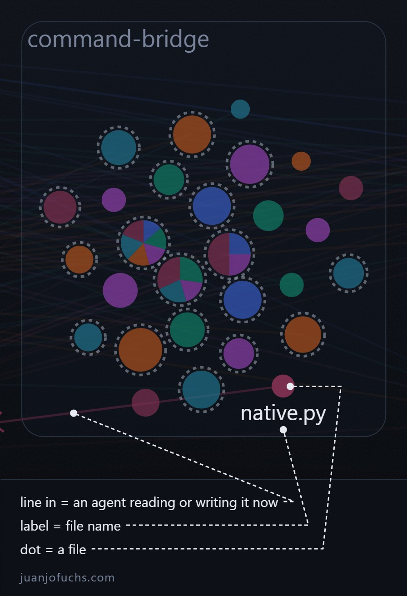
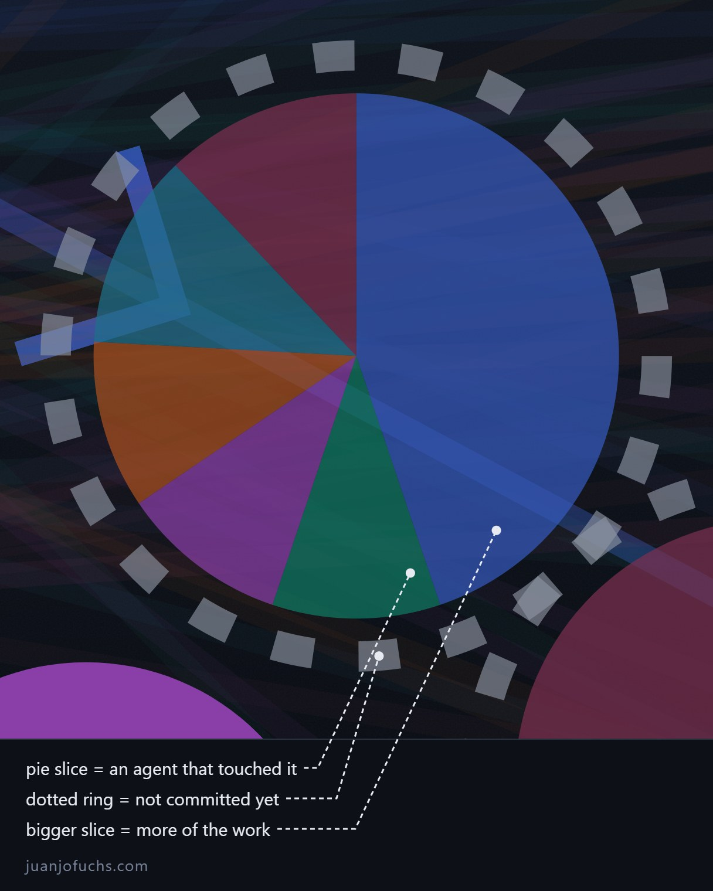
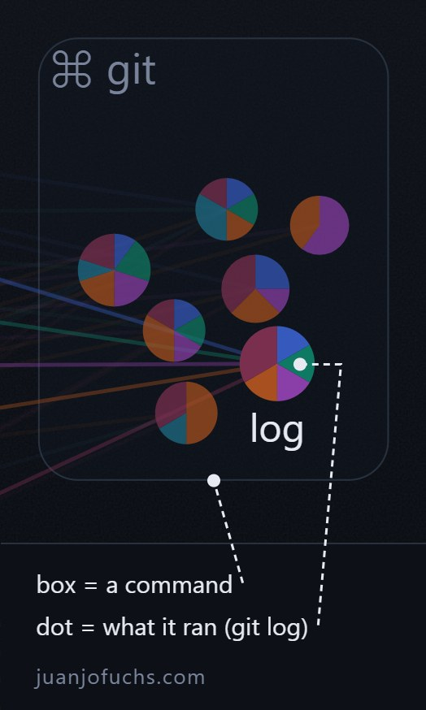
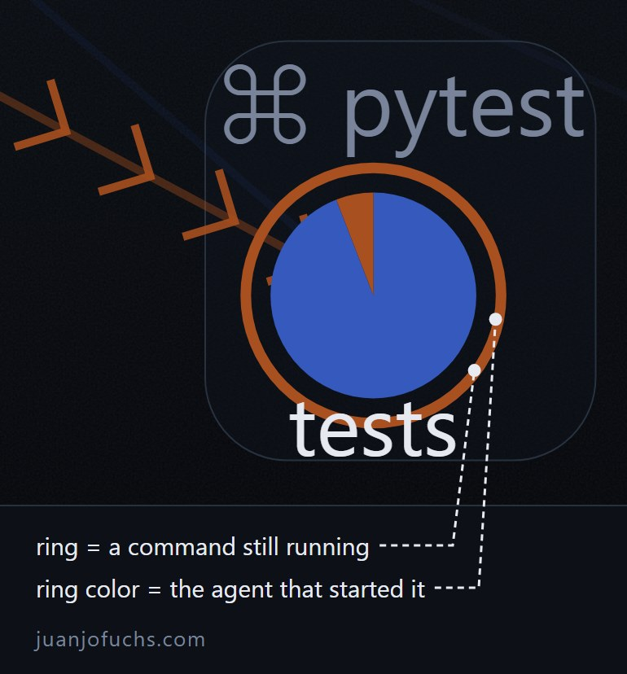
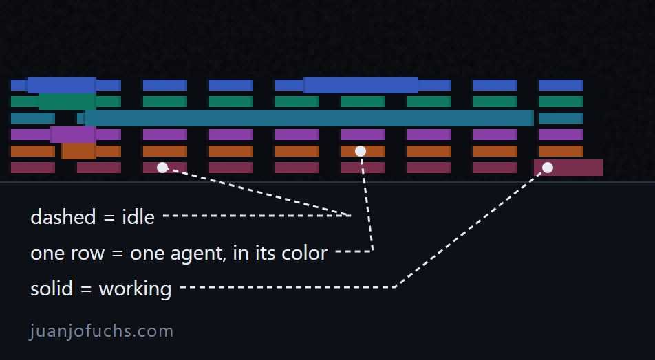

  

    <video style="position: absolute; top: 0; left: 0; width: 100%; height: 100%;"
           autoplay loop muted playsinline
           aria-label="Agents work in the sunflower view as one agent's line lights up to a .env file dot, then the same agent runs rm -rf and its command box lights up."
           poster="/assets/2026-11-17-sunflower-hero.jpg">
      <source src="/assets/videos/2026-11-17-sunflower-hero.mp4" type="video/mp4">
    </video>
  

I've been using [Command Bridge](https://github.com/JuanjoFuchs/command-bridge), the voice tool I built for my agents, daily for a few months now. Being able to talk to [just one of them, who manages all the others](https://juanjofuchs.com/blog/chief-of-staff), has let me grow my fleet and take on more projects. However, another key to scaling this up, at least for personal productivity, is transparency. Seeing in real time what they're reading, writing, executing, etc., or whether they're idle.

## Watching the terminal

I don't use Claude Code CLI anymore, nor Codex CLI, although these two harnesses still run everything underneath. I just use Command Bridge. I used to open these CLIs in Windows Terminal, one pane per agent, so I could always see what they were doing. The messages flew by on the screen and I'd catch things like one of them editing something it shouldn't, writing a new file that didn't make sense, or running a command unrelated to my ask. That was manageable with three panes and got hard by six.

The tool calls and long walls of text also got harder to follow the longer they ran. I liked [a post](https://www.linkedin.com/posts/swernst_what-72-agents-building-software-actually-share-7511392633764724737-jO0P/) that showed agent loops literally as loops, some bigger, some smaller. I found that way of visualizing their work interesting, but not useful to me.

## Catching a rogue agent

What I needed instead was a more persistent way to trace their actions at a glance. I wanted to see which repos they were working in, which files they were reading and writing, and which commands they were executing.

That lets me catch a rogue agent doing something it shouldn't. In the clip at the top, one of them reads a `.env` file and then runs a recursive delete, and I see each one the moment it happens. I have written rules and permissions around this, and seeing it happen gives me yet another layer of control.

## The sunflower view

So I built this view for Command Bridge that shows the whole fleet working at once. Each agent is a card on the left, each repo is a box, and each file they touch is a dot inside its repo. Lines connect each card to what it's reading, writing or running right now, so I can see who's doing what across all my repos. I wanted this view to be objective, not generated by AI. So, it reads what each session is actually doing from the Claude Code and Codex session logs and git, all locally.

  

    <video style="position: absolute; top: 0; left: 0; width: 100%; height: 100%;"
           autoplay loop muted playsinline
           aria-label="Close-up of the busiest repo, with agent-colored pie slices filling file dots and lines lighting up as agents work."
           poster="/assets/2026-11-17-sunflower-zoom.jpg">
      <source src="/assets/videos/2026-11-17-sunflower-zoom.mp4" type="video/mp4">
    </video>
  

Each agent has a card on the left with its name and current state, like thinking, speaking or idle. I can follow each one by its color, which stays the same on its card, its lines and its pie slices. Each card also has a bar showing how much of the agent's context window it has used.

Each repo gets a box, and each dot inside is a file that's been touched. The dots keep their places in the sunflower spiral. Files outside a repo go in a "no repo" box.

A dot grows with the interactions to that file. Its pie slices show each agent's share of those touches. I can match the largest slice to an agent's color to see who touched the file most. A dotted gray ring means the file isn't committed yet. Dots and their lines dim as activity gets older, and old ones drop off.

The lines connect each agent to what it's doing. For 15 seconds after activity, small arrows move toward a file for an edit or write, and back toward the card for a read. More arrows mean more tokens read or written. Each command gets a dot in its tool's box, so `git log` is the log dot in the git box. A running command has a slowly pulsing ring in the color of whoever started it.

The lines at the bottom are a timeline of each agent, solid while it's working and dashed while it's idle.

## Organizing the view

I was exploring ways to pack a lot of information into this view and still read it at a glance. At first I was directing the agent on how to place the objects, I wanted the dots in something like a grid, with the newer ones on the outside, like a timeline of what was touched. I was forcing it to place the dots in a particular way and it was struggling to implement it exactly how I wanted it, I guess I failed to describe all the different scenarios for it, so I eventually gave up and asked it for the best way to organize them, and it suggested the [sunflower spiral](https://en.wikipedia.org/wiki/Fermat%27s_spiral#The_golden_ratio_and_the_golden_angle), so the dots never pile up.

The repos went the same way. I asked it to put the repo boxes in a particular way, it struggled, and when I asked for the best way it suggested [skyline packing](https://github.com/juj/RectangleBinPack/blob/master/RectangleBinPack.pdf), like Tetris: each new box drops into the lowest open spot, so there are no gaps. The dots sit in a spiral inside each repo, and the boxes pack together.

It looked better than what I was imagining.

## What comes next

I'm still exploring the best way to direct many agents at a time and do multiple things in parallel. In order to continue to scale this up, it's important to be able to understand and see live what all the agents are doing, so I catch issues early and keep the ownership of what they do. The sunflower view is how I do that today.


## Social Campaign
CAMPAIGN: sunflower-view_20261117
TIMEZONE: America/New_York

### Tuesday - Why I needed to see my agents
DATE: 2026-11-17
TIME: 12:00
MEDIA: /assets/videos/2026-11-17-sunflower-social-tuesday.mp4
ALT: Agents work across repo boxes of file dots, lines lighting up as they read, write and run commands, titled How I Watch What My Coding Agents Are Doing.

#### LinkedIn Post
I used to open Claude Code and Codex in Windows Terminal, one pane per agent, so I could always see what they were doing. The messages flew by and I'd catch one editing something it shouldn't, writing a new file that didn't make sense, or running a command unrelated to my ask. That was manageable with three panes and got hard by six.

Now I talk to one agent through Command Bridge, the voice tool I built, and it manages all the others. That has let me grow my fleet and take on more projects. Another key to scaling this up is transparency, seeing in real time what they're reading, writing and executing, or whether they're idle.

So I built the sunflower view. Each agent is a card on the left, each repo is a box, and each file they touch is a dot inside its repo. Lines connect each card to what it's reading, writing or running right now, so I can see who's doing what across all my repos.

I wanted it to be objective, not generated by AI. It reads what each session is actually doing from the Claude Code and Codex session logs and git, all locally.

How I Watch What My Coding Agents Are Doing
https://juanjofuchs.com/blog/sunflower-view

#AI #AIAgents #ClaudeCode #DataVisualization

#### X/Twitter Thread
Tweet 1:
I used to watch my coding agents in one terminal pane each. The messages flew by and I'd catch one editing a file it shouldn't. That was manageable with three panes and got hard by six.

Tweet 2:
So I built the sunflower view in Command Bridge. Each agent is a card, each repo a box, each file a dot, and lines show who's reading, writing or running what right now.

Tweet 3:
The sunflower view reads the Claude Code and Codex session logs and git, all locally, so no AI interprets what my agents are doing. https://juanjofuchs.com/blog/sunflower-view #AIAgents

### Wednesday - How to read the dots, pies and rings
DATE: 2026-11-18
TIME: 12:00
MEDIA: /assets/videos/2026-11-17-sunflower-social-wednesday.mp4
ALT: Close-up of a repo box as an agent's arrows reach a file dot, a pie with a dotted ring, titled How I Watch What My Coding Agents Are Doing.

#### LinkedIn Post
In the sunflower view I built for Command Bridge, I can follow each agent by its color, which stays the same on its card, its lines and its pie slices. Each card shows its current state, like thinking, speaking or idle, and a bar with how much of its context window it has used.

Each repo gets a box, and each file that's been touched is a dot inside it. A dot grows with the interactions to that file, and its pie slices show each agent's share, so I can match the largest slice to a color to see who touched it most. A dotted gray ring means the file isn't committed yet. Dots dim as activity gets older, and old ones drop off.

For 15 seconds after activity, small arrows move toward a file for an edit or write, and back toward the card for a read. More arrows mean more tokens read or written. Each command gets a dot in its tool's box, so git log is the log dot in the git box, and a running command has a slowly pulsing ring in the color of whoever started it.

At the bottom, a timeline shows each agent, solid while it's working and dashed while it's idle.

How I Watch What My Coding Agents Are Doing
https://juanjofuchs.com/blog/sunflower-view

#AI #AIAgents #DataVisualization

#### X/Twitter Thread
Tweet 1:
In my sunflower view, each file my coding agents touch is a dot, and the dot is a pie chart. Each slice is one agent's share, so the biggest slice tells me who touched it most.

Tweet 2:
A dotted gray ring around a file dot in my sunflower view means the file isn't committed yet, so I can spot uncommitted work across all my repos at a glance.

Tweet 3:
Each agent card in my sunflower view has a bar with how much of its context window it has used, and a timeline at the bottom is solid while it works and dashed while it's idle. https://juanjofuchs.com/blog/sunflower-view #DataVisualization

### Thursday - Catching a rogue agent
DATE: 2026-11-19
TIME: 12:00
MEDIA: /assets/videos/2026-11-17-sunflower-social-thursday.mp4
ALT: One agent's line lights up to a .env file dot, then runs to an rm -rf command box, titled How I Watch What My Coding Agents Are Doing.

#### LinkedIn Post
I needed a persistent way to trace what my coding agents do at a glance: which repos they're working in, which files they're reading and writing, and which commands they're executing.

That lets me catch a rogue agent doing something it shouldn't. In the clip at the top of the post, one of them reads a .env file and then runs a recursive delete. Its line lights up to the .env dot, then its command box lights up, and I see each one the moment it happens.

I have written rules and permissions around this, and seeing it happen gives me yet another layer of control. That only works if the view is objective, so the sunflower view doesn't ask an AI what the agents are doing. It reads the Claude Code and Codex session logs and git, all locally, and draws what each session actually did.

How I Watch What My Coding Agents Are Doing
https://juanjofuchs.com/blog/sunflower-view

#AI #AIAgents #Observability

#### X/Twitter Thread
Tweet 1:
In my sunflower view, when a coding agent reads a .env file and then runs a recursive delete, I see each one the moment it happens.

Tweet 2:
I have rules and permissions around what my coding agents can do. Seeing their reads, writes and commands live gives me yet another layer of control.

Tweet 3:
My sunflower view reads Claude Code and Codex session logs and git locally, so it draws what each agent actually did, with no AI interpreting it. https://juanjofuchs.com/blog/sunflower-view #Observability

### Friday - The layouts I tried
DATE: 2026-11-20
TIME: 12:00
MEDIA: /assets/2026-11-17-sunflower-card-friday.jpg
ALT: Repo boxes packed together, each with file dots in a spiral, titled How I Watch What My Coding Agents Are Doing.

#### LinkedIn Post
I was exploring ways to pack a lot of information into the sunflower view and still read it at a glance. At first I was directing the agent building it on how to place the objects. I wanted the file dots in something like a grid, with the newer ones on the outside, like a timeline of what was touched.

It was struggling to implement it exactly how I wanted it, and I guess I failed to describe all the different scenarios for it. So I eventually gave up and asked it for the best way to organize them, and it suggested a sunflower spiral, so the dots never pile up.

The repos went the same way. I asked it to place the repo boxes in a particular way, it struggled, and when I asked for the best way it suggested skyline packing, like Tetris: each new box drops into the lowest open spot, so there are no gaps. It looked better than what I was imagining.

I'm still exploring the best way to direct many agents at a time and do multiple things in parallel. To keep scaling this up, I need to see live what they're all doing, so I catch issues early and keep the ownership of what they do.

How are you keeping track of what your agents are doing?

How I Watch What My Coding Agents Are Doing
https://juanjofuchs.com/blog/sunflower-view

#AI #AIAgents #DataVisualization

#### X/Twitter Thread
Tweet 1:
I told the coding agent building my sunflower view exactly where to place the file dots. It struggled, so I asked it for the best way, and it suggested a sunflower spiral so the dots never pile up.

Tweet 2:
For the repo boxes in my sunflower view, the agent suggested skyline packing, like Tetris: each new box drops into the lowest open spot, so there are no gaps. It looked better than what I was imagining.

Tweet 3:
To keep scaling up how many coding agents I run in parallel, I need to see live what they're all doing, so I catch issues early and keep the ownership of their work. https://juanjofuchs.com/blog/sunflower-view #AIAgents

---

## Newsletter
SUBJECT: How I keep an eye on my coding agents
PREVIEW: I built the sunflower view to see live what my agents read, write and run, straight from their session logs.
MEDIA: /assets/2026-11-17-sunflower-hero.jpg
ALT: Agent cards beside repos of file pies, with one agent's line running to an rm -rf command box.

I used to open Claude Code and Codex in Windows Terminal, one pane per agent, so I could always see what they were doing. I'd catch one editing something it shouldn't or running a command unrelated to my ask. That was manageable with three panes and got hard by six.

Now I talk to one agent through Command Bridge and it manages the others, which has let me take on more projects. Another key to scaling this up is transparency, so I built the sunflower view. Each agent is a card, each repo is a box, and each file they touch is a dot inside its repo, with lines showing who's reading, writing or running what right now. It reads the session logs and git, all locally, so no AI interprets what they're doing.

Each dot is a pie chart of which agents touched the file, and a dotted gray ring means it isn't committed yet. Each card shows how much of its context window the agent has used, and a timeline at the bottom shows who's working and who's idle. When one of them reads a .env file and then runs a recursive delete, I see each one the moment it happens.

I didn't design the layout myself. I kept telling the agent building it where to place the dots and boxes, it struggled, so I asked it for the best way. It suggested a sunflower spiral for the files and skyline packing for the repos, and it looked better than what I was imagining.

Read the full post: https://juanjofuchs.com/blog/sunflower-view

---

INSTRUCTIONS:
Post each campaign slot at 12:00 America/New_York on its listed date.
Attach the hero to the first tweet of each thread and keep the blog link in the final tweet.
