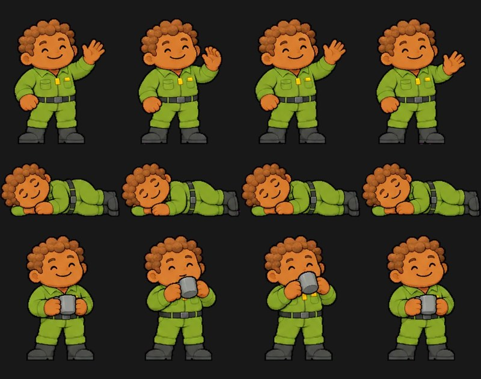

  

    <video style="position: absolute; top: 0; left: 0; width: 100%; height: 100%;"
           autoplay loop muted playsinline
           aria-label="A colony with workstations, a central ladder, a cafeteria, sleeping agents in bunks and a roster of faces below."
           poster="/assets/2026-11-24-tni-hero.jpg">
      <source src="/assets/2026-11-24-tni-hero.mp4" type="video/mp4">
    </video>
  

I made this realtime viewer for my Claude Code agents, inspired by [Oxygen Not Included](https://www.klei.com/games/oxygen-not-included). I've been experimenting with parsing Claude Code's session logs and finding ways to see multiple parallel sessions work in real time, because I needed a way to see what all my agents are doing at once. Last week I wrote about the [sunflower view](https://juanjofuchs.com/blog/sunflower-view). This is Tokens Not Included, or TNI, which I've been using for around four weeks now.

I haven't open sourced it yet, so this is a sneak preview.

## Why a colony

I wanted to make watching my agents work fun and nice to look at, and I've always been a fan of ONI, although I haven't played it in a while.

Most of the agent viewers out there use office layouts, where agents sit at a desk in front of a computer. [Pixel Agents](https://github.com/pablodelucca/pixel-agents) is the biggest of them, with over 10,000 GitHub stars. I didn't like that. What's the point? Everybody, even us, is already looking at monitors.

I wanted an Oxygen Not Included colony, with multiple floors and machines for the work they're doing. I wanted the agents to actually run around the colony and operate the machinery.

[The sunflower view](https://juanjofuchs.com/blog/sunflower-view) shows a lot more information, and I find it valuable when I want the detail. But I tend to keep the TNI tab open more often because I like looking at it. I like seeing the agents running around, doing stuff, talking to each other, etc. It lets me keep an eye on what they're doing, and it's fun. It feels like I'm working, doing my job, but I'm also kind of playing ONI.

## Reading the colony

In Tokens Not Included, floors are repositories. Code files, including scripts, sources and tests, are machines; notes, docs and other non-code files are bookshelves. In this close-up of the [Command Bridge](https://github.com/JuanjoFuchs/command-bridge) repo floor, the machines are labeled `cli.py`, `test_watch.py` and `server.py`, and one of the agents is thinking with a hand on its chin.

  

    <video style="position: absolute; top: 0; left: 0; width: 100%; height: 100%;"
           autoplay loop muted playsinline
           aria-label="Agents at cli.py, test_watch.py and server.py machines on a repo floor, one thinking with a hand on its chin."
           poster="/assets/2026-11-24-tni-scene-2-poster.jpg">
      <source src="/assets/2026-11-24-tni-scene-2.mp4" type="video/mp4">
    </video>
  

Commands are stations, like a phone switchboard for `herdr`, a record press for `git`, or a rocket for `docker`. Commands that don't belong to a repo get their own floor of stations. On the commands floor below, an agent hammers at the `pytest` machine next to the Command Bridge gauges station. I can see the command it's running by where it's working.

  

    <video style="position: absolute; top: 0; left: 0; width: 100%; height: 100%;"
           autoplay loop muted playsinline
           aria-label="An agent hammers at the pytest machine on the commands floor beside the Command Bridge gauges station."
           poster="/assets/2026-11-24-tni-scene-3-poster.jpg">
      <source src="/assets/2026-11-24-tni-scene-3.mp4" type="video/mp4">
    </video>
  

The characters' life bars are their context windows, and the station bars show how much each agent has interacted with them.

I love how the agents sleep in their beds when they're not running, go get some coffee in the cafeteria when idle, or talk to each other when coordinating. Here an idle agent drinks coffee while another climbs the ladder. It's really fun to watch my agents do my work this way.

  

    <video style="position: absolute; top: 0; left: 0; width: 100%; height: 100%;"
           autoplay loop muted playsinline
           aria-label="An idle agent drinks coffee in the cafeteria while another agent climbs the ladder beside it."
           poster="/assets/2026-11-24-tni-scene-4-poster.jpg">
      <source src="/assets/2026-11-24-tni-scene-4.mp4" type="video/mp4">
    </video>
  

## Making the art

I made this with Claude. I've been working on it over nights and weekends for over a month, iterating on the feedback I collected while watching it. I told Claude to prompt Codex to generate the art sprites, then Claude cut them, cleaned them and upscaled them. It was amazing to watch it iterate on its own to get the art looking good, and I watched it all through TNI too.

For example, Claude suggested upscaling the art because Codex returns about 1.5 megapixels per image, roughly 300 pixels per pose on a 16-pose sheet. It also cleaned up the magenta backgrounds around the sprites. I could see weird magenta edges around the agents, and some was still showing in one agent's glasses as we worked through the cleanup.

## What comes next

Next I'm adding overlays like in ONI. In Oxygen Not Included you switch on a layer and see how air moves, where liquids flow, how the electricity runs through the colony's machines. I want the same for my agents: one kind of information on top of the world at a time.

A token heat map shows where the work is happening: heat pools around each agent by how many tokens it's using a minute, and streams toward the machines its calls land on. A spend overlay treats money like power. Each machine plugs into a socket that shows what it's drawing, in dollars per hour. Hovering a socket shows which agents drew from it, how many calls and what each cost.

A git overlay draws each repo as a timeline, with bars for lines added and lines removed, per commit, scrolling with time. And on the machines themselves, a small clock shows how long a script has been running for.

My goal is to pack as much information about my agents' behavior as possible. Suggestions are welcome.

## Agents in other worlds

[Age of Agents](https://agentsmill.github.io/age-of-agents/) already has settlers walking to workshops according to the tool they're using. [claude-village](https://haimadrian.github.io/claude-village/) maps tools to zones in a Minecraft-style village. People are putting agents in offices, strategy maps, villages, and now an ONI-style colony.

All this tells me that folks want to see their agents work, and want it to be something they enjoy watching. Someone even asked for Terraria and This War of Mine skins. We're going to be using more agents, and we want to watch them work in these worlds that we love.

Maybe working with agents starts to look more like playing a game. I don't know where this goes, but we hand our agents real jobs, and we want to keep an eye on them while they work, in a world we actually enjoy looking at.

Tokens Not Included isn't affiliated with Klei, who make Oxygen Not Included.

The [TNI repo](https://github.com/JuanjoFuchs/tokens-not-included) is up with a preview, and the sources and install are coming soon. Keep an eye out for the next post.


KIT_SENT: 2026-11-24T17:03:08Z
## Social Campaign
CAMPAIGN: tokens-not-included_20261124
TIMEZONE: America/New_York

### Tuesday - Why a colony
DATE: 2026-11-24
TIME: 12:00
MEDIA: /assets/2026-11-24-tni-social-tuesday.mp4
ALT: A wide colony with repository floors, a cafeteria and sleeping agents in bunks, titled Tokens Not Included.

#### LinkedIn Post
PUBLISHED: 2026-11-24T17:03:02.598Z

I made this realtime viewer for my Claude Code agents, inspired by Oxygen Not Included (ONI). I've been experimenting with parsing Claude Code's session logs and finding ways to see multiple parallel sessions work in real time, because I needed a way to see what all my agents are doing at once. Last week I wrote about the sunflower view. This is Tokens Not Included, or TNI, which I've been using for around four weeks now.

Most of the agent viewers out there use office layouts, where agents sit at a desk in front of a computer. I didn't like that. What's the point? Everybody, even us, is already looking at monitors. I wanted a colony like the game's, with multiple floors and machines for the work they're doing.

The sunflower view shows a lot more information, but I keep the TNI tab open more often because I like seeing the agents running around, doing stuff, talking to each other. And even though I'm working, doing my job, it feels like I'm also kind of playing ONI.

Tokens Not Included
https://juanjofuchs.com/blog/tokens-not-included

#AIAgents #ClaudeCode #DataVisualization

#### X/Twitter Thread
PUBLISHED: 2026-11-24T17:03:07.888Z

Tweet 1:
I made a realtime viewer for my Claude Code agents, inspired by Oxygen Not Included, because I needed a way to see what all my agents are doing at once. I've been using it for around four weeks now.

Tweet 2:
Most agent viewers use office layouts, where agents sit at a desk in front of a computer. What's the point? Everybody, even us, is already looking at monitors. So mine is a colony, with floors and machines the agents run around and operate.

Tweet 3:
My sunflower view shows more information, but I keep the colony open more often because I like seeing the agents running around. Even though I'm working, it feels like I'm also kind of playing the game. https://juanjofuchs.com/blog/tokens-not-included

### Wednesday - Reading the colony
DATE: 2026-11-25
TIME: 12:00
MEDIA: /assets/2026-11-24-tni-social-wednesday.mp4
ALT: An agent hammers at the pytest machine beside the Command Bridge gauges station, titled Tokens Not Included.

#### LinkedIn Post
In Tokens Not Included, floors are repositories. Code files, including scripts, sources and tests, are machines; notes, docs and other non-code files are bookshelves.

Commands are stations, like a phone switchboard for herdr, a record press for git, or a rocket for docker. Commands that don't belong to a repo get their own floor of stations. An agent hammers at the pytest machine next to the Command Bridge gauges station. I can see the command it's running by where it's working.

The characters' life bars are their context windows, and the station bars show how much each agent has interacted with them.

I love how the agents sleep in their beds when they're not running, go get some coffee in the cafeteria when idle, or talk to each other when coordinating. It's really fun to watch my agents do my work this way.

Tokens Not Included
https://juanjofuchs.com/blog/tokens-not-included

#AIAgents #ClaudeCode #DataVisualization

#### X/Twitter Thread
Tweet 1:
In my agent colony, floors are repositories. Code files, including scripts, sources and tests, are machines; notes, docs and other non-code files are bookshelves. Commands that don't belong to a repo get their own floor of stations.

Tweet 2:
In the colony, commands are stations, like a record press for git or a rocket for docker. The characters' life bars are their context windows, and the station bars show how much each agent has interacted with them.

Tweet 3:
I love how the agents in my colony sleep in their beds when they're not running, get coffee in the cafeteria when idle, or talk to each other when coordinating. https://juanjofuchs.com/blog/tokens-not-included

### Thursday - Making the art and adding overlays
DATE: 2026-11-26
TIME: 12:00
MEDIA: /assets/2026-11-24-tni-social-thursday.mp4
ALT: Agents at the cli.py, test_watch.py and server.py machines, one with a hand on its chin, titled Tokens Not Included.

#### LinkedIn Post
I told Claude to prompt Codex to generate the art sprites for Tokens Not Included, then Claude cut them, cleaned them and upscaled them. It was amazing to watch it iterate on its own to get the art looking good, and I watched it all happen through the colony too.

Claude suggested upscaling the art because Codex returns about 1.5 megapixels per image, roughly 300 pixels per pose on a 16-pose sheet. It also cleaned up the magenta backgrounds around the sprites. I could see weird magenta edges around the agents, and some was still showing in one agent's glasses as we worked through the cleanup.

Next I'm adding overlays like in Oxygen Not Included. There you switch on a layer and see how air moves, where liquids flow, how the electricity runs through the colony's machines. I want the same for my agents: one kind of information on top of the world at a time.

A token heat map shows where the big reads and writes are. A spend overlay treats money like power, with sockets showing what each machine is drawing in dollars per hour. A git overlay draws each repo as a timeline, with bars for lines added and lines removed, per commit. My goal is to pack as much information about my agents' behavior as possible. Suggestions are welcome.

Tokens Not Included
https://juanjofuchs.com/blog/tokens-not-included

#AIAgents #ClaudeCode #Codex #DataVisualization

#### X/Twitter Thread
Tweet 1:
I told Claude to prompt Codex to generate the art sprites for my agent colony, then Claude cut them, cleaned them and upscaled them. It also cleaned up the magenta backgrounds. I could see weird magenta edges around the agents.

Tweet 2:
Claude suggested upscaling the sprites because Codex returns about 1.5 megapixels per image, roughly 300 pixels per pose on a 16-pose sheet. I watched it all happen through the colony too.

Tweet 3:
Next I'm adding overlays to my agent colony like in Oxygen Not Included: a token heat map of the big reads and writes, a spend overlay that treats money like power, and a git timeline per repo. Suggestions are welcome. https://juanjofuchs.com/blog/tokens-not-included

### Friday - Agents in other worlds
DATE: 2026-11-27
TIME: 12:00
MEDIA: /assets/2026-11-24-tni-social-friday.mp4
ALT: An agent drinks coffee in the cafeteria while another climbs the ladder, titled Tokens Not Included.

#### LinkedIn Post
Age of Agents already has settlers walking to workshops according to the tool they're using. claude-village maps tools to zones in a Minecraft-style village. People are putting agents in offices, strategy maps, villages, and now in an Oxygen Not Included-style colony I made for my Claude Code agents.

All this tells me that folks want to see their agents work, and want it to be something they enjoy watching. Someone even asked for Terraria and This War of Mine skins. We're going to be using more agents, and we want to watch them work in these worlds that we love.

Maybe working with agents starts to look more like playing a game. I don't know where this goes, but we hand our agents real jobs, and we want to keep an eye on them while they work, in a world we actually enjoy looking at.

Tokens Not Included
https://juanjofuchs.com/blog/tokens-not-included

#AI #AIAgents #ClaudeCode

#### X/Twitter Thread
Tweet 1:
Age of Agents has settlers walking to workshops according to the tool they're using. claude-village maps tools to zones in a Minecraft-style village. People are putting agents in offices, strategy maps, villages, and now in my Oxygen Not Included-style colony.

Tweet 2:
Folks want to see their agents work, and want it to be something they enjoy watching. Someone even asked for Terraria and This War of Mine skins. We're going to be using more agents, and we want to watch them work in these worlds that we love.

Tweet 3:
Maybe working with agents starts to look more like playing a game. We hand our agents real jobs, and we want to keep an eye on them while they work, in a world we actually enjoy looking at. https://juanjofuchs.com/blog/tokens-not-included

---

## Newsletter
SUBJECT: Working with my agents, kind of playing ONI
PREVIEW: Tokens Not Included is my colony viewer for Claude Code agents.
MEDIA: /assets/2026-11-24-tni-hero.jpg
ALT: A colony with repository floors, a central ladder, a cafeteria and sleeping agents in bunks.

I made this realtime viewer for my Claude Code agents, inspired by Oxygen Not Included (ONI), because I needed a way to see what all my agents are doing at once. This is Tokens Not Included, or TNI, which I've been using for around four weeks now. The sunflower view shows a lot more information, but I keep the TNI tab open more often because I like seeing the agents running around, doing stuff, talking to each other. And even though I'm working, doing my job, it feels like I'm also kind of playing ONI.

Floors are repositories. Code files are machines; notes, docs and other non-code files are bookshelves. Commands are stations, like a record press for git or a rocket for docker. The characters' life bars are their context windows. I love how the agents sleep in their beds when they're not running and get coffee in the cafeteria when idle.

I told Claude to prompt Codex to generate the art sprites, then Claude cut them, cleaned them and upscaled them. It also cleaned up the magenta backgrounds around the sprites. Next I'm adding overlays like in ONI: a token heat map of the big reads and writes, a spend overlay that treats money like power, and a git timeline per repo. My goal is to pack as much information about my agents' behavior as possible. Suggestions are welcome.

People are putting agents in offices, strategy maps, villages, and now an ONI-style colony. Someone even asked for Terraria and This War of Mine skins. Maybe working with agents starts to look more like playing a game. We hand our agents real jobs, and we want to keep an eye on them in a world we enjoy looking at. The sources and install are coming soon.

Read the full post: https://juanjofuchs.com/blog/tokens-not-included

---

INSTRUCTIONS:
Post each campaign slot at 12:00 America/New_York on its listed date.
